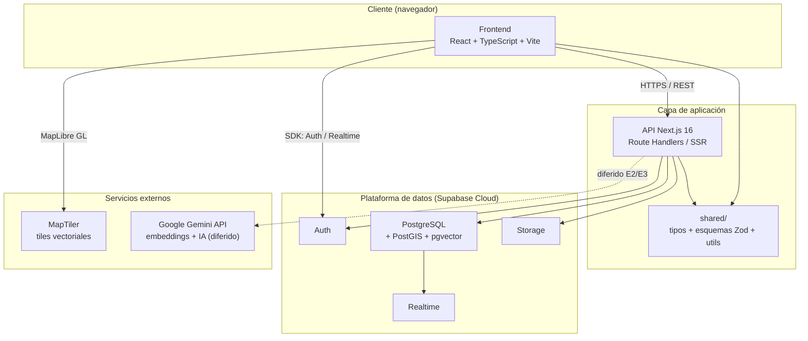
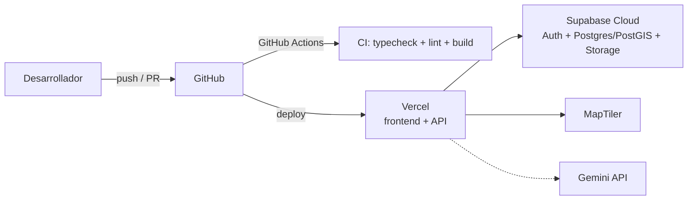
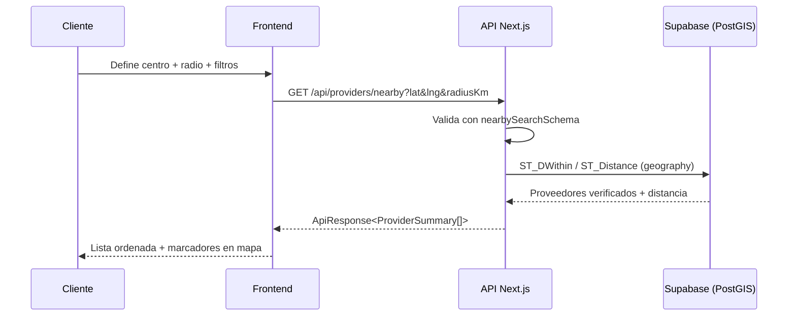
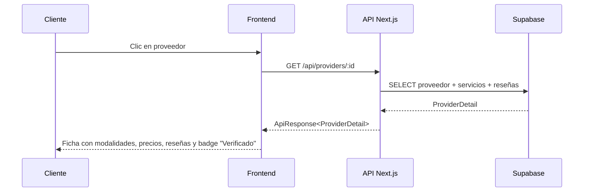
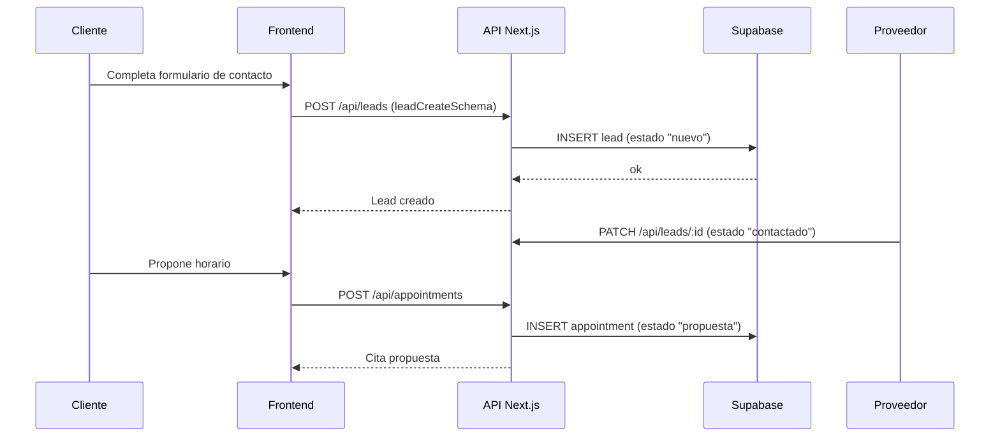
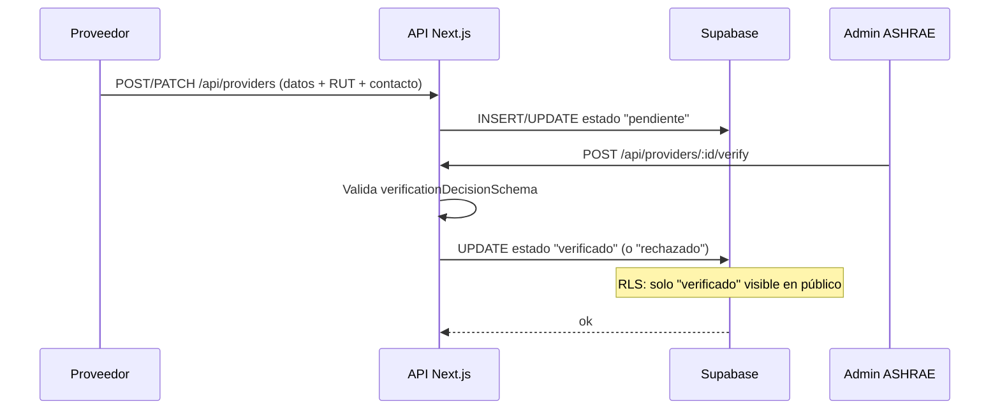
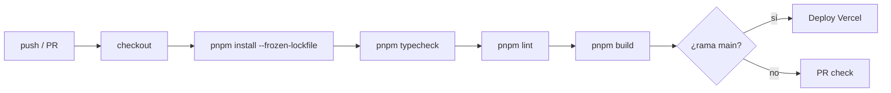

# Documento de Diseño — Marketplace HVAC

> Software Architecture Document (SAD) — Entrega E2/E3

---

## Portada

| Campo                   | Detalle                                                                                         |
| ----------------------- | ----------------------------------------------------------------------------------------------- |
| **Proyecto**            | Marketplace HVAC                                                                                |
| **Descripción**         | Plataforma web tipo Uber/Rappi para encontrar y contratar proveedores HVAC verificados en Chile |
| **Asignatura**          | IIC3113 — Gestión de Proyectos TI (PMBOK 6.ª edición)                                           |
| **Grupo**               | Grupo 1                                                                                         |
| **Cliente / Sponsor**   | ASHRAE Chile                                                                                    |
| **Contraparte cliente** | Adriana Bastías — Gerente TI, ASHRAE Chile                                                      |
| **Contraparte técnica** | Raúl Pacheco — ASHRAE Full Member                                                               |
| **Gerente de Proyecto** | Dan Villablanca                                                                                 |
| **Fecha**               | 24 de noviembre de 2026                                                                         |
| **Versión**             | 1.0                                                                                             |
| **Estado**              | Línea base de diseño (baseline E2)                                                              |

### Control de versiones

| Versión | Fecha      | Autor          | Descripción                         |
| ------- | ---------- | -------------- | ----------------------------------- |
| 0.1     | 2026-09-24 | Equipo Grupo 1 | Borrador inicial de arquitectura    |
| 0.9     | 2026-11-10 | Equipo Grupo 1 | Revisión con sponsor (ASHRAE Chile) |
| 1.0     | 2026-11-24 | Equipo Grupo 1 | Línea base de diseño para E3        |

---

## 1. Resumen ejecutivo

**Marketplace HVAC** es una plataforma web que conecta a clientes finales (hogares, empresas, industria) con **proveedores de servicios HVAC verificados** en Chile. El producto resuelve un problema concreto del mercado local: la oferta de servicios de climatización, ventilación, calefacción y refrigeración está fragmentada, sin canales de confianza que permitan saber si un proveedor existe, está certificado y cumple lo ofrecido.

La propuesta de valor se apoya en tres pilares:

1. **Confianza** — perfiles verificados con RUT, nombre, teléfono y correo validados por ASHRAE Chile, más reseñas de clientes reales.
2. **Cercanía** — búsqueda geoespacial real sobre mapa (MapLibre GL + MapTiler) que ordena proveedores por distancia al cliente.
3. **Simplicidad** — flujo de contacto y agendamiento en pocos pasos, con datos consistentes entre la interfaz y la base de datos.

El diseño adopta una arquitectura **cliente-servidor desacoplada** con un frontend React + TypeScript (Vite), una capa de API Next.js 16 y un backend gestionado Supabase (Auth, PostgreSQL + PostGIS + pgvector, Storage y Realtime). La integración con Google Gemini (embeddings + IA) se contempla desde el diseño, pero se **difiere funcionalmente a E2/E3** mediante un _stub_.

La dirección de arte elegida es **"Aire Limpio"** (documentada en `brand-y-ui-kit.md`), derivada del cian histórico de Hawaii Chile (`#6ACBEE`) modernizado hacia un primario `#0EA5C9`, con _light mode_ por defecto y _dark mode_ opcional.

El MVP es **solo web**, con presupuesto de herramientas gratuitas o de bajo costo, y plazo de entrega **24/11/2026**.

---

## 2. Objetivos y alcance

### 2.1 Objetivos

| ID    | Objetivo                                                                   | Criterio de éxito                                  |
| ----- | -------------------------------------------------------------------------- | -------------------------------------------------- |
| OBJ-1 | Permitir que un cliente encuentre proveedores HVAC cercanos y verificados  | Búsqueda por radio operativa en < 2 s (p95)        |
| OBJ-2 | Garantizar que todo proveedor visible tenga verificación mínima            | 100 % de fichas públicas con estado `verificado`   |
| OBJ-3 | Asegurar consistencia de datos entre frontend, API y base de datos         | Cero divergencias en pruebas de integración        |
| OBJ-4 | Mostrar un mapa real y actualizado con la ubicación de los proveedores     | Mapa MapLibre renderizado con tiles vigentes       |
| OBJ-5 | Entregar un CRUD cohesionado con el modelo de datos                        | Alta/edición/baja de proveedor sin inconsistencias |
| OBJ-6 | Construir una base extensible para un asistente IA sobre manuales técnicos | Arquitectura preparada (pgvector) aunque diferida  |

### 2.2 Dentro del alcance (MVP)

- Registro y autenticación de **clientes**, **proveedores** y **administradores (ASHRAE)**.
- Perfil de proveedor con **verificación mínima** (RUT, nombre, teléfono, correo) y estados `pendiente → en_revision → verificado | rechazado`.
- Búsqueda de proveedores por **radio geográfico**, filtros por segmento (residencial / comercial / industrial) y servicio.
- **Mapa** interactivo con marcadores, _clusters_ y ficha lateral.
- **Ficha de proveedor** con modalidades, precios "desde", reseñas y datos de contacto.
- Flujo de **contacto (lead)** y **agendamiento** básico (propuesta / confirmada / realizada / cancelada).
- **Reseñas** de clientes sobre proveedores.
- Panel de administración para verificación de proveedores.
- _Seed_ de proveedores demo para demostración.

### 2.3 Fuera del alcance (explícitamente excluido)

| Exclusión                                                               | Justificación                                                       |
| ----------------------------------------------------------------------- | ------------------------------------------------------------------- |
| Aplicación móvil nativa (iOS/Android)                                   | Restricción de plazo; MVP solo web responsive                       |
| Pasarela de pagos / facturación en línea                                | No requerido por el sponsor para el MVP                             |
| Asistente IA/RAG sobre manuales técnicos **funcional**                  | Diferido a E2/E3; solo se deja la arquitectura preparada            |
| Verificación documental avanzada (certificados, acreditaciones SGS/ISO) | MVP se limita a verificación mínima (RP1)                           |
| Mensajería en tiempo real entre cliente y proveedor                     | Realtime queda habilitado en la infraestructura, no en el flujo MVP |
| Soporte multi-idioma                                                    | Localización única **es-CL**                                        |
| Integración con sistemas ERP/CRM de proveedores                         | Fuera del problema de negocio priorizado                            |
| Cobertura fuera de Chile                                                | Datos y geografía acotados a Chile                                  |

---

## 3. Stakeholders

| Stakeholder      | Rol                      | Interés principal                                                                | Influencia |
| ---------------- | ------------------------ | -------------------------------------------------------------------------------- | ---------- |
| ASHRAE Chile     | Sponsor / Cliente        | Que la plataforma posicione proveedores confiables y eleve el estándar del rubro | Alta       |
| Adriana Bastías  | Gerente TI, ASHRAE Chile | Viabilidad técnica, seguridad y mantenibilidad                                   | Alta       |
| Raúl Pacheco     | ASHRAE Full Member       | Rigor técnico HVAC y pertinencia de la verificación                              | Media      |
| Dan Villablanca  | Gerente de Proyecto      | Cumplimiento de alcance, plazo y presupuesto                                     | Alta       |
| Equipo Grupo 1   | Desarrollo               | Entregar un MVP funcional y documentado                                          | Alta       |
| Proveedores HVAC | Usuario final (oferta)   | Visibilidad, captación de clientes, gestión de perfil                            | Media      |
| Clientes finales | Usuario final (demanda)  | Encontrar rápido un proveedor de confianza cerca                                 | Media      |
| Docentes IIC3113 | Evaluadores              | Aplicación de PMBOK 6 y calidad de entregables                                   | Media      |

---

## 4. Requisitos

### 4.1 Requisitos funcionales

| ID      | Requisito                         | Descripción                                                                                                               | Prioridad | Componente responsable                               |
| ------- | --------------------------------- | ------------------------------------------------------------------------------------------------------------------------- | --------- | ---------------------------------------------------- |
| **RP1** | Verificación mínima del proveedor | Un proveedor no es visible públicamente hasta que un admin ASHRAE valida RUT, nombre, teléfono y correo.                  | Must      | `backend` + `supabase` (RLS) + panel admin           |
| **RP2** | Consistencia de datos             | Los datos mostrados en frontend deben provenir del mismo contrato (`shared/`) y persistirse sin divergencias en Postgres. | Must      | `shared` + `backend` + `frontend`                    |
| **RP3** | Mapa real y actualizado           | El mapa debe renderizar tiles reales y posiciones vigentes de proveedores, con actualización al mover/zoom.               | Must      | `frontend` (MapLibre/MapTiler) + `backend` (PostGIS) |
| **RP4** | CRUD cohesionado con la BD        | Crear, leer, actualizar y eliminar proveedores/servicios reflejando el modelo relacional y geoespacial.                   | Must      | `backend` + `supabase`                               |

#### RP1 — Verificación mínima (detalle)

- Estados: `pendiente`, `en_revision`, `verificado`, `rechazado`.
- Campos obligatorios validados: RUT (con dígito verificador), nombre/razón social, teléfono `+56 9 XXXX XXXX`, correo.
- Solo proveedores en estado `verificado` aparecen en búsqueda, mapa y ficha pública.
- La decisión de verificación se registra con `verificationDecisionSchema` (decisión + nota).

#### RP2 — Consistencia de datos (detalle)

- Los esquemas Zod en `shared/src/schemas/` son la **única fuente de verdad** de validación, compartida entre frontend y backend.
- Los tipos en `shared/src/types/` definen el contrato (`ProviderSummary`, `ProviderDetail`, `Lead`, `Appointment`, `Review`).
- Los tipos de base de datos se generan con `supabase gen types typescript` hacia `shared/src/types/database.ts`.

#### RP3 — Mapa real y actualizado (detalle)

- Tiles vectoriales servidos por MapTiler, renderizados con MapLibre GL.
- Las consultas de cercanía usan PostGIS (`ST_DWithin`, `ST_Distance`) sobre `geography(Point, 4326)`.
- El frontend refetch al cambiar radio, centro o filtros (React Query).

#### RP4 — CRUD cohesionado (detalle)

- Endpoints REST en Next.js: `GET/POST/PATCH/DELETE /api/providers`, `/api/providers/[id]`, `/api/providers/[id]/services`.
- Toda mutación pasa por validación Zod y por políticas RLS según rol.

### 4.2 Requisitos no funcionales

| ID     | Categoría      | Requisito                    | Métrica / Criterio                                |
| ------ | -------------- | ---------------------------- | ------------------------------------------------- |
| RNF-1  | Rendimiento    | Carga percibida              | **LCP < 2.5 s**, **INP < 200 ms** en 4G simulada  |
| RNF-2  | Rendimiento    | Búsqueda de cercanía         | Respuesta API p95 < 800 ms para radio ≤ 50 km     |
| RNF-3  | Accesibilidad  | Nivel de conformidad         | **WCAG 2.1 AA** (contraste, foco, teclado)        |
| RNF-4  | Seguridad      | Autenticación y autorización | Auth Supabase + JWT + RLS por rol                 |
| RNF-5  | Seguridad      | Validación de entrada        | 100 % de endpoints validados con Zod              |
| RNF-6  | Mantenibilidad | Monorepo tipado              | TypeScript estricto, `typecheck` y `lint` en CI   |
| RNF-7  | Usabilidad     | Curva de uso                 | Encontrar y contactar un proveedor en ≤ 4 pasos   |
| RNF-8  | Localización   | Idioma y formatos            | **es-CL** (CLP, RUT, teléfono, fechas dd-mm-aaaa) |
| RNF-9  | Portabilidad   | Responsive                   | Web usable en ≥ 360 px de ancho                   |
| RNF-10 | Disponibilidad | Entorno de demo              | Disponible durante la presentación de E3          |

---

## 5. Arquitectura de alto nivel

### 5.1 Vista de capas



### 5.2 Estructura del monorepo

```
HVAC-Marketplace/
├── frontend/        # App React + TS + Vite (SPA)
├── backend/         # API Next.js 16 (Route Handlers)
├── shared/          # Contratos: tipos, esquemas Zod, utilidades
├── supabase/        # Migraciones SQL, políticas RLS, seed
├── docs/            # Documentación (este documento y brand/UI kit)
├── .github/         # CI (GitHub Actions)
├── turbo.json       # Orquestación de tareas (Turborepo)
└── pnpm-workspace.yaml
```

### 5.3 Vista de despliegue (resumen)



---

## 6. Descripción de componentes

### 6.1 `frontend/` — Cliente web

| Aspecto         | Detalle                                                                                                                                    |
| --------------- | ------------------------------------------------------------------------------------------------------------------------------------------ |
| Tecnología      | React 19 + TypeScript 5.7, Vite 8, Tailwind CSS 4                                                                                          |
| Enrutamiento    | `react-router-dom` 7                                                                                                                       |
| Estado servidor | `@tanstack/react-query` 5                                                                                                                  |
| UI              | Componentes propios sobre Radix UI, `class-variance-authority`, `lucide-react`                                                             |
| Animación       | `motion` (ex Framer Motion)                                                                                                                |
| Mapas           | `maplibre-gl` + tiles MapTiler                                                                                                             |
| Supabase        | `@supabase/supabase-js` (Auth/Realtime)                                                                                                    |
| Validación      | Zod (esquemas de `shared/`)                                                                                                                |
| Páginas         | `HomePage`, `SearchPage`, `MapPage`, `ProviderPage`, `ForProvidersPage`, `LoginPage`, `RegisterPage`, `ChatPage`, `panel/`, `NotFoundPage` |

**Responsabilidades:** presentación, interacción, validación de formularios en cliente (reutilizando `shared/`), consumo de API y del SDK de Supabase, render del mapa y de la ficha de proveedor.

### 6.2 `backend/` — Capa de API

| Aspecto           | Detalle                                                                        |
| ----------------- | ------------------------------------------------------------------------------ |
| Tecnología        | Next.js 16 (Route Handlers / Server)                                           |
| Validación        | Zod (esquemas de `shared/`)                                                    |
| Acceso a datos    | Cliente Supabase (anon + service role según contexto)                          |
| Responsabilidades | Orquestar reglas de negocio, aplicar RLS, exponer REST, integrar Gemini (stub) |

**Endpoints previstos (contrato):**

| Método | Ruta                        | Descripción                    | Rol                       |
| ------ | --------------------------- | ------------------------------ | ------------------------- |
| GET    | `/api/providers/nearby`     | Búsqueda geoespacial por radio | Público                   |
| GET    | `/api/providers/:id`        | Ficha de proveedor             | Público (solo verificado) |
| POST   | `/api/providers`            | Alta de proveedor              | `proveedor`               |
| PATCH  | `/api/providers/:id`        | Actualización de proveedor     | `proveedor` (propio)      |
| DELETE | `/api/providers/:id`        | Baja lógica                    | `proveedor`/`admin`       |
| POST   | `/api/providers/:id/verify` | Decisión de verificación       | `admin`                   |
| POST   | `/api/leads`                | Crear contacto                 | `cliente`                 |
| PATCH  | `/api/leads/:id`            | Actualizar estado              | `proveedor`/`cliente`     |
| POST   | `/api/appointments`         | Proponer agendamiento          | `cliente`                 |
| PATCH  | `/api/appointments/:id`     | Cambiar estado                 | `cliente`/`proveedor`     |
| POST   | `/api/reviews`              | Crear reseña                   | `cliente`                 |
| POST   | `/api/chat`                 | Asistente IA (diferido)        | Público/`cliente`         |

### 6.3 `shared/` — Contratos compartidos

| Módulo     | Contenido                                                                                                           |
| ---------- | ------------------------------------------------------------------------------------------------------------------- |
| `schemas/` | `auth`, `provider`, `search`, `lead`, `appointment`, `review` (Zod)                                                 |
| `types/`   | `USER_ROLES`, estados, `ProviderSummary`, `ProviderDetail`, `ApiResponse<T>`, etc.                                  |
| `utils/`   | `rut.ts` (validación/normalización), `format.ts` (CLP/teléfono), `constants.ts` (categorías, modalidades, regiones) |

**Beneficio:** elimina la duplicación de reglas y garantiza RP2 (consistencia) por construcción.

### 6.4 `supabase/` — Plataforma de datos

| Servicio       | Uso                                                               |
| -------------- | ----------------------------------------------------------------- |
| **Auth**       | Registro/login, JWT, roles (`cliente`, `proveedor`, `admin`)      |
| **PostgreSQL** | Modelo relacional (proveedores, servicios, leads, citas, reseñas) |
| **PostGIS**    | Tipos geográficos y consultas de cercanía                         |
| **pgvector**   | Embeddings de manuales técnicos (habilitado, uso diferido)        |
| **Storage**    | Imágenes/archivos de proveedor                                    |
| **Realtime**   | Base para notificaciones futuras                                  |

### 6.5 Módulo IA (`ChatPage` + Gemini) — diferido

- Contrato ya definido (`chatSchema`), endpoint `/api/chat` y modelo `gemini-2.5-flash` / `gemini-embedding-001` configurados por entorno.
- Con `GEMINI_API_KEY` vacío se usa un **stub** que responde de forma controlada.
- La columna `vector(1536)` y pgvector quedan preparadas para RAG sobre manuales técnicos.

---

## 7. Stack tecnológico

| Capa     | Tecnología         | Versión                                     | Justificación                                              |
| -------- | ------------------ | ------------------------------------------- | ---------------------------------------------------------- |
| Frontend | React              | 19.3                                        | Ecosistema maduro, componentes reutilizables               |
| Frontend | TypeScript         | 5.7                                         | Tipado estricto, seguridad en refactors                    |
| Frontend | Vite               | 8.3                                         | Build rápido, DX óptima, bajo costo                        |
| Frontend | Tailwind CSS       | 4.3                                         | Design tokens directos, consistencia visual                |
| Frontend | React Router       | 7.18                                        | Enrutamiento SPA estándar                                  |
| Frontend | TanStack Query     | 5.103                                       | Caché y sincronización de datos del servidor               |
| Frontend | Radix UI           | últimos                                     | Accesibilidad AA de base, sin estilos impuestos            |
| Frontend | lucide-react       | 1.48                                        | Iconografía consistente y liviana                          |
| Frontend | motion             | 13.4                                        | Animaciones declarativas, respeta reduced-motion           |
| Frontend | maplibre-gl        | 6.11                                        | Mapas vectoriales open source, sin lock-in                 |
| Backend  | Next.js            | 16                                          | API + SSR en un solo runtime, despliegue simple            |
| Backend  | Zod                | 3.24                                        | Validación declarativa compartida                          |
| Datos    | Supabase           | Cloud                                       | Auth + Postgres + PostGIS + pgvector + Storage gestionados |
| Datos    | PostgreSQL/PostGIS | gestionado                                  | Consultas geoespaciales reales (RP3)                       |
| IA       | Google Gemini      | `gemini-2.5-flash` / `gemini-embedding-001` | Embeddings + generación, capa gratuita (diferido)          |
| Mapas    | MapTiler           | Cloud                                       | Tiles vectoriales, capa gratuita 100k tiles/mes            |
| Build    | pnpm + Turborepo   | 12.4 / 2.3                                  | Monorepo eficiente, tareas cacheadas                       |
| CI/CD    | GitHub Actions     | —                                           | Automatización gratuita en repositorio                     |
| Hosting  | Vercel             | —                                           | Despliegue de frontend + API Next.js                       |

> **Restricción de presupuesto:** todo el stack se apoya en capas gratuitas o de bajo costo (Vercel Hobby, Supabase Free, MapTiler Free, Gemini Free Tier).

---

## 8. Modelo de integración (APIs externas)

| Integración                  | Dirección           | Protocolo                 | Autenticación               | Datos intercambiados               |
| ---------------------------- | ------------------- | ------------------------- | --------------------------- | ---------------------------------- |
| **MapLibre GL ↔ MapTiler**   | Frontend → MapTiler | HTTPS (tiles vectoriales) | `VITE_MAPTILER_KEY`         | Tiles, estilos, geocodificación    |
| **Frontend → API Next.js**   | Frontend → Backend  | HTTPS / JSON (REST)       | JWT Bearer (cuando aplica)  | Proveedores, leads, citas, reseñas |
| **Backend → Supabase**       | Backend → Supabase  | HTTPS (PostgREST/SDK)     | `SUPABASE_SERVICE_ROLE_KEY` | Consultas/mutaciones con RLS       |
| **Frontend → Supabase Auth** | Frontend → Supabase | HTTPS (SDK)               | `SUPABASE_ANON_KEY`         | Sesión, JWT, refresh               |
| **Backend → Gemini**         | Backend → Google    | HTTPS / JSON              | `GEMINI_API_KEY`            | Prompts, embeddings (**diferido**) |

### Variables de entorno (referencia)

```bash
# Backend
SUPABASE_URL=http://127.0.0.1:54321
SUPABASE_ANON_KEY=...
SUPABASE_SERVICE_ROLE_KEY=...
GEMINI_API_KEY=                 # vacío => stub
GEMINI_CHAT_MODEL=gemini-2.5-flash
GEMINI_EMBEDDING_MODEL=gemini-embedding-001
GEMINI_EMBEDDING_DIM=1536
FRONTEND_ORIGIN=http://localhost:5173
BACKEND_PORT=3001

# Frontend
VITE_API_BASE_URL=http://localhost:3001
VITE_SUPABASE_URL=http://127.0.0.1:54321
VITE_SUPABASE_ANON_KEY=...
VITE_MAPTILER_KEY=...
```

---

## 9. Flujos principales

### 9.1 Buscar proveedores por radio



### 9.2 Ver ficha de proveedor



### 9.3 Contactar / agendar



### 9.4 Verificación de proveedor (RP1)



---

## 10. Seguridad

| Control                   | Implementación                                                                |
| ------------------------- | ----------------------------------------------------------------------------- |
| **Autenticación**         | Supabase Auth (email/password), JWT firmado, refresh tokens                   |
| **Autorización**          | RLS por rol: `cliente`, `proveedor`, `admin`                                  |
| **Aislamiento de datos**  | Un proveedor solo edita su propia ficha; admin gestiona verificación          |
| **Visibilidad pública**   | Solo `verification_status = 'verificado'` es legible por anon                 |
| **Validación de entrada** | Zod en cliente y servidor (misma fuente en `shared/`)                         |
| **Gestión de secretos**   | Variables de entorno; nunca en el repositorio (`.env.example` como plantilla) |
| **CORS**                  | Restringido a `FRONTEND_ORIGIN`                                               |
| **Transporte**            | HTTPS en todos los entornos productivos                                       |
| **Service role**          | Solo en backend; nunca expuesta al cliente                                    |

### Matriz de permisos (resumen)

| Recurso                              | anon | cliente | proveedor (propio) | admin |
| ------------------------------------ | ---- | ------- | ------------------ | ----- |
| Proveedores verificados (lectura)    | ✅   | ✅      | ✅                 | ✅    |
| Proveedores no verificados (lectura) | ❌   | ❌      | ✅ (propio)        | ✅    |
| Crear/editar proveedor               | ❌   | ❌      | ✅                 | ✅    |
| Decidir verificación                 | ❌   | ❌      | ❌                 | ✅    |
| Crear lead                           | ❌   | ✅      | ❌                 | ❌    |
| Actualizar estado de lead            | ❌   | parcial | ✅                 | ✅    |
| Crear reseña                         | ❌   | ✅      | ❌                 | ❌    |

---

## 11. Despliegue

### 11.1 Entornos

| Entorno    | Frontend/API        | Datos                                 | Uso            |
| ---------- | ------------------- | ------------------------------------- | -------------- |
| Local      | Vite dev + Next dev | Supabase local (`npx supabase start`) | Desarrollo     |
| Producción | Vercel              | Supabase Cloud                        | Demo / entrega |

### 11.2 Pipeline CI/CD



**Disparadores CI (GitHub Actions):** push a `main`, `develop`, `draft/**`, `feature/**`; PR hacia `main` y `develop`. Pasos: typecheck → lint → build (con `NEXT_TELEMETRY_DISABLED=1`).

### 11.3 Base de datos

- Migraciones versionadas en `supabase/` y aplicadas con `supabase db reset`/`migration up`.
- Tipos generados: `pnpm db:types` → `shared/src/types/database.ts`.
- _Seed_ de proveedores demo para la demostración de E3.

---

## 12. Estrategia de pruebas

| Nivel             | Objetivo                                          | Herramientas / Enfoque                                |
| ----------------- | ------------------------------------------------- | ----------------------------------------------------- |
| **Estático**      | Errores de tipo y estilo                          | `pnpm typecheck` (tsc) + `pnpm lint` (prettier) en CI |
| **Unitario**      | Lógica de `shared/` (RUT, formatos, esquemas Zod) | Pruebas sobre `shared/src/utils` y `schemas`          |
| **Integración**   | Contratos API ↔ BD (RP2, RP4)                     | Pruebas de endpoints contra Supabase local            |
| **Geoespacial**   | Correctitud de cercanía (RP3)                     | Casos con coordenadas conocidas y radios fijos        |
| **E2E**           | Flujos críticos de usuario                        | Búsqueda → ficha → contacto → agendamiento            |
| **Accesibilidad** | Conformidad AA                                    | Auditoría de contraste, foco y navegación por teclado |
| **Rendimiento**   | LCP < 2.5 s, INP < 200 ms                         | Medición con Lighthouse / Web Vitals                  |
| **Aceptación**    | Validación con el sponsor                         | Demo guiada con ASHRAE Chile                          |

**Criterios de salida (E3):** CI en verde, flujos E2E principales operativos, 0 hallazgos críticos de accesibilidad y consistencia validada entre capas.

---

## 13. Riesgos técnicos y mitigaciones

| ID     | Riesgo                                                                  | Prob. | Impacto | Mitigación                                                                              |
| ------ | ----------------------------------------------------------------------- | ----- | ------- | --------------------------------------------------------------------------------------- |
| **R1** | Datos de proveedores incompletos o falsos que rompan RP1                | Media | Alto    | Validación Zod estricta (RUT/contacto) + verificación humana por admin ASHRAE + estados |
| **R2** | Inconsistencia de datos entre frontend y BD (RP2)                       | Media | Alto    | Contratos en `shared/` como fuente única + tipos generados desde Supabase               |
| **R3** | Mapa desactualizado o sin tiles por límites/cuotas (RP3)                | Media | Medio   | Capa gratuita MapTiler monitoreada + caché de tiles + fallback a lista                  |
| **R4** | Desviaciones en el CRUD que corrompan relaciones (RP4)                  | Media | Alto    | Migraciones versionadas + RLS + pruebas de integración + borrado lógico                 |
| **R5** | Dependencia de servicios externos (Gemini, MapTiler) y cuotas gratuitas | Media | Medio   | _Stub_ de IA, degradación elegante del mapa, variables de entorno configurables         |

> Los riesgos R1–R5 se alinean con los identificados en el Caso de Negocio (E1) y se reevalúan en cada reporte de avance semanal.

---

## 14. Decisiones diferidas

| Decisión                                   | Estado                           | Fundamento                                                  | Revisión          |
| ------------------------------------------ | -------------------------------- | ----------------------------------------------------------- | ----------------- |
| Módulo IA/RAG sobre manuales técnicos      | **Diferido a E2/E3**             | Requiere curación de corpus y embeddings; no bloquea el MVP | Al cerrar RP1–RP4 |
| Uso de `pgvector` y `gemini-embedding-001` | Preparado, no activo             | Infraestructura lista; falta ingesta de manuales            | E3                |
| Realtime (notificaciones en vivo)          | Preparado, no activo             | Mejora de experiencia, no crítica para el MVP               | Post-MVP          |
| Almacenamiento de archivos (certificados)  | Storage habilitado, flujo mínimo | Verificación avanzada fuera de alcance                      | Post-MVP          |
| Pagos en línea                             | Descartado del MVP               | No requerido por el sponsor                                 | Futuro            |

---

## 15. Trazabilidad requisito → componente

| Requisito                     | Frontend                 | Backend                              | shared/                                  | supabase/       | Servicio externo | Verificación                 |
| ----------------------------- | ------------------------ | ------------------------------------ | ---------------------------------------- | --------------- | ---------------- | ---------------------------- |
| **RP1** Verificación mínima   | Panel admin, badges      | `/verify`, RLS                       | `provider`, `verificationDecisionSchema` | RLS + estados   | —                | Prueba de integración + demo |
| **RP2** Consistencia de datos | Consumo tipado           | Validación Zod                       | Tipos + esquemas + `database.ts`         | Tipos generados | —                | `typecheck` + integración    |
| **RP3** Mapa real             | `maplibre-gl`, `MapPage` | `/nearby`                            | `nearbySearchSchema`, `GeoPoint`         | PostGIS         | MapTiler         | Prueba geoespacial + visual  |
| **RP4** CRUD cohesionado      | Formularios CRUD         | `/providers` (GET/POST/PATCH/DELETE) | `providerUpsertSchema`                   | Tablas + RLS    | —                | E2E + integración            |
| RNF-1 Rendimiento             | Code-splitting, `motion` | Índices, paginación                  | —                                        | Índices PostGIS | Vercel edge      | Lighthouse                   |
| RNF-3 Accesibilidad           | Radix UI, foco visible   | —                                    | —                                        | —               | —                | Auditoría AA                 |
| RNF-4 Seguridad               | Sesión SDK               | JWT, service role                    | `auth` schemas                           | Auth + RLS      | Supabase         | Matriz de permisos           |
| RNF-8 Localización            | Formatos CLP/RUT         | —                                    | `rut.ts`, `format.ts`                    | —               | —                | Pruebas unitarias            |

---

## Anexos

- **A.1** `docs/diseno/brand-y-ui-kit.md` — Brand book y UI kit ("Aire Limpio").
- **A.2** `docs/diseno/documento-de-diseno.md` — Este documento.
- **A.3** Código fuente: `frontend/`, `backend/`, `shared/`, `supabase/`.
- **A.4** Caso de Negocio y Acta de Constitución (E1) — Grupo 1, IIC3113.
