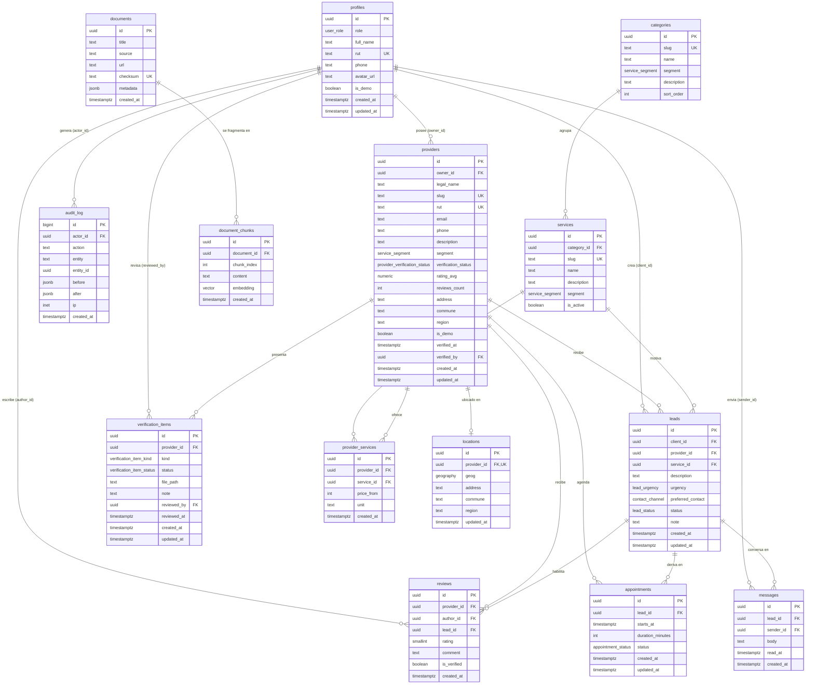

# Modelo de datos — Marketplace HVAC

> **Proyecto:** Marketplace HVAC (Grupo 1 / ASHRAE Chile) — IIC3113
> **Componente:** Backend Next.js 16 (API-only, App Router + Route Handlers) · Supabase (Postgres + PostGIS + pgvector)
> **Idioma:** español (es-CL) · **Estado:** diseño E1
> **Documento hermano:** [`api.md`](./api.md)

---

## 1. Alcance y principios de diseño

Este documento especifica el modelo de datos relacional del Marketplace HVAC: tablas, tipos,
restricciones, índices, integridad, seguridad a nivel de fila (RLS), consultas geoespaciales y
vectoriales, y la estrategia de datos de demostración.

Principios rectores:

| Principio                  | Descripción                                                                                                                    | Requisito asociado |
| -------------------------- | ------------------------------------------------------------------------------------------------------------------------------ | ------------------ |
| **Consistencia primero**   | Los `enum` y `CHECK` viven en la base de datos; los `zod` de `@hvac/shared` son la misma fuente de verdad en la frontera HTTP. | RP2                |
| **Geoespacial nativo**     | Las coordenadas se almacenan como `geography(Point, 4326)` con índice GiST; nunca como texto.                                  | RP3                |
| **Verificación auditable** | El estado de verificación es un campo con máquina de estados + bitácora en `audit_log`.                                        | RP1                |
| **CRUD cohesionado**       | `leads`, `appointments`, `reviews` y `messages` giran en torno al ciclo de contratación.                                       | RP4                |
| **Degradación elegante**   | El flag `is_demo` permite poblar y demostrar la plataforma sin depender de datos reales.                                       | R1                 |

### 1.1 Requisitos y riesgos referenciados

| Código  | Descripción                                                           |
| ------- | --------------------------------------------------------------------- |
| **RP1** | Verificación de proveedores (RUT, documentos, decisión ASHRAE/admin). |
| **RP2** | Consistencia de datos entre frontend, API y base de datos.            |
| **RP3** | Mapa real con cercanía geoespacial y distancias verificables.         |
| **RP4** | CRUD cohesionado del ciclo solicitud → cotización → cita → reseña.    |
| **R1**  | Riesgo de baja adopción / falta de proveedores reales al inicio.      |

---

## 2. Diagrama entidad-relación



> `profiles.id` referencia `auth.users(id)` (gestionado por Supabase Auth). `document_chunks.embedding`
> es de tipo `vector(1536)`. `locations.geog` es de tipo `geography(Point, 4326)`.

---

## 3. Tipos enumerados (enums)

Se implementan como `CREATE TYPE ... AS ENUM`, manteniéndolos sincronizados con las constantes
`as const` de `shared/src/types/index.ts`.

| Enum                           | Valores                                                             | Origen en `@hvac/shared`       |
| ------------------------------ | ------------------------------------------------------------------- | ------------------------------ |
| `user_role`                    | `cliente`, `proveedor`, `admin`                                     | `USER_ROLES`                   |
| `provider_verification_status` | `pendiente`, `en_revision`, `verificado`, `rechazado`               | `PROVIDER_VERIFICATION_STATUS` |
| `lead_status`                  | `nuevo`, `contactado`, `cotizado`, `cerrado`, `perdido`             | `LEAD_STATUS`                  |
| `lead_urgency`                 | `baja`, `media`, `alta`                                             | inline en `leadCreateSchema`   |
| `contact_channel`              | `telefono`, `whatsapp`, `correo`                                    | inline en `leadCreateSchema`   |
| `appointment_status`           | `propuesta`, `confirmada`, `realizada`, `cancelada`                 | `APPOINTMENT_STATUS`           |
| `service_segment`              | `residencial`, `comercial`, `industrial`                            | `SERVICE_SEGMENTS`             |
| `verification_item_kind`       | `rut`, `boleta`, `certificado_ashrae`, `seguro`, `licencia`, `otro` | —                              |
| `verification_item_status`     | `pendiente`, `aprobado`, `rechazado`                                | —                              |

**Justificación:** los `enum` nativos evitan valores fuera de catálogo, ocupan poco espacio y permiten
que el planner de Postgres aplique `CHECK` implícito. Su contrapartida (dificultad para agregar
valores) se acepta porque los catálogos son estables y versionados con migraciones.

---

## 4. Diccionario de datos

Convenciones: `uuid` = `uuid DEFAULT gen_random_uuid()`; marcas de tiempo en `timestamptz` con
`DEFAULT now()`; `updated_at` mantenido por trigger (`set_updated_at`).

### 4.1 `profiles`

Perfil de aplicación vinculado 1:1 con `auth.users`. Extiende la identidad de Supabase Auth con rol y
datos chilenos.

| Columna      | Tipo          | Restricciones                                           | Descripción                                                 |
| ------------ | ------------- | ------------------------------------------------------- | ----------------------------------------------------------- |
| `id`         | `uuid`        | PK, FK → `auth.users(id)` `ON DELETE CASCADE`           | Identidad de autenticación.                                 |
| `role`       | `user_role`   | `NOT NULL DEFAULT 'cliente'`                            | Rol de plataforma.                                          |
| `full_name`  | `text`        | `NOT NULL`, `CHECK (char_length(trim(full_name)) >= 3)` | Nombre completo.                                            |
| `rut`        | `text`        | `UNIQUE`, nullable                                      | RUT normalizado (sin puntos ni guion, con DV en mayúscula). |
| `phone`      | `text`        | `CHECK (phone ~ '^\+56\d{9}$')`, nullable               | Teléfono E.164 chileno.                                     |
| `avatar_url` | `text`        | nullable                                                | URL de avatar (Storage).                                    |
| `is_demo`    | `boolean`     | `NOT NULL DEFAULT false`                                | Marca de dato de demostración.                              |
| `created_at` | `timestamptz` | `NOT NULL DEFAULT now()`                                | Alta.                                                       |
| `updated_at` | `timestamptz` | `NOT NULL DEFAULT now()`                                | Última modificación (trigger).                              |

### 4.2 `providers`

Empresa o profesional HVAC. Es la entidad central del marketplace.

| Columna               | Tipo                           | Restricciones                                                         | Descripción                                    |
| --------------------- | ------------------------------ | --------------------------------------------------------------------- | ---------------------------------------------- |
| `id`                  | `uuid`                         | PK                                                                    | Identificador.                                 |
| `owner_id`            | `uuid`                         | `NOT NULL`, FK → `profiles(id)` `ON DELETE CASCADE`                   | Usuario propietario (rol `proveedor`).         |
| `legal_name`          | `text`                         | `NOT NULL`, `CHECK (char_length(trim(legal_name)) BETWEEN 3 AND 160)` | Razón social.                                  |
| `slug`                | `text`                         | `NOT NULL UNIQUE`, `CHECK (slug ~ '^[a-z0-9-]+$')`                    | Identificador legible para URL.                |
| `rut`                 | `text`                         | `NOT NULL UNIQUE`                                                     | RUT de la empresa (módulo 11 validado en app). |
| `email`               | `text`                         | `NOT NULL`, `CHECK (email ~* '^[^@\s]+@[^@\s]+\.[^@\s]+$')`           | Correo de contacto.                            |
| `phone`               | `text`                         | `NOT NULL`, `CHECK (phone ~ '^\+56\d{9}$')`                           | Teléfono de contacto.                          |
| `description`         | `text`                         | `CHECK (char_length(description) <= 2000)`, nullable                  | Descripción comercial.                         |
| `segment`             | `service_segment`              | `NOT NULL`                                                            | Sector objetivo.                               |
| `verification_status` | `provider_verification_status` | `NOT NULL DEFAULT 'pendiente'`                                        | Estado en el flujo RP1.                        |
| `rating_avg`          | `numeric(3,2)`                 | `CHECK (rating_avg BETWEEN 1 AND 5)`, nullable                        | Promedio de reseñas (trigger).                 |
| `reviews_count`       | `integer`                      | `NOT NULL DEFAULT 0`, `CHECK (reviews_count >= 0)`                    | N.º de reseñas (trigger).                      |
| `address`             | `text`                         | `NOT NULL`, `CHECK (char_length(trim(address)) BETWEEN 4 AND 200)`    | Dirección textual.                             |
| `commune`             | `text`                         | `NOT NULL`                                                            | Comuna (Chile).                                |
| `region`              | `text`                         | `NOT NULL`                                                            | Región (Chile).                                |
| `city`                | `text`                         | nullable                                                              | Ciudad/etiqueta corta para UI.                 |
| `is_demo`             | `boolean`                      | `NOT NULL DEFAULT false`                                              | Marca de semilla demo.                         |
| `verified_at`         | `timestamptz`                  | nullable                                                              | Fecha de aprobación.                           |
| `verified_by`         | `uuid`                         | FK → `profiles(id)` `ON DELETE SET NULL`, nullable                    | Admin que aprobó.                              |
| `created_at`          | `timestamptz`                  | `NOT NULL DEFAULT now()`                                              | Alta.                                          |
| `updated_at`          | `timestamptz`                  | `NOT NULL DEFAULT now()`                                              | Última modificación.                           |

### 4.3 `categories`

Catálogo de categorías de servicio HVAC (agrupador de `services`).

| Columna       | Tipo              | Restricciones        | Descripción            |
| ------------- | ----------------- | -------------------- | ---------------------- |
| `id`          | `uuid`            | PK                   | Identificador.         |
| `slug`        | `text`            | `NOT NULL UNIQUE`    | Slug estable.          |
| `name`        | `text`            | `NOT NULL`           | Nombre visible.        |
| `segment`     | `service_segment` | `NOT NULL`           | Segmento por defecto.  |
| `description` | `text`            | nullable             | Descripción.           |
| `sort_order`  | `integer`         | `NOT NULL DEFAULT 0` | Orden de presentación. |

### 4.4 `services`

Servicio concreto ofrecible (coherente con `SERVICE_CATEGORIES` de `@hvac/shared`).

| Columna       | Tipo              | Restricciones                                          | Descripción             |
| ------------- | ----------------- | ------------------------------------------------------ | ----------------------- |
| `id`          | `uuid`            | PK                                                     | Identificador.          |
| `category_id` | `uuid`            | `NOT NULL`, FK → `categories(id)` `ON DELETE RESTRICT` | Categoría padre.        |
| `slug`        | `text`            | `NOT NULL UNIQUE`                                      | Slug estable.           |
| `name`        | `text`            | `NOT NULL`                                             | Nombre del servicio.    |
| `description` | `text`            | nullable                                               | Detalle.                |
| `segment`     | `service_segment` | `NOT NULL`                                             | Segmento.               |
| `is_active`   | `boolean`         | `NOT NULL DEFAULT true`                                | Disponible en catálogo. |

### 4.5 `provider_services`

Tabla puente N:M entre proveedores y servicios, con precio de entrada y unidad.

| Columna       | Tipo          | Restricciones                                        | Descripción                                   |
| ------------- | ------------- | ---------------------------------------------------- | --------------------------------------------- |
| `id`          | `uuid`        | PK                                                   | Identificador.                                |
| `provider_id` | `uuid`        | `NOT NULL`, FK → `providers(id)` `ON DELETE CASCADE` | Proveedor.                                    |
| `service_id`  | `uuid`        | `NOT NULL`, FK → `services(id)` `ON DELETE RESTRICT` | Servicio.                                     |
| `price_from`  | `integer`     | `CHECK (price_from >= 0)`, nullable                  | Precio desde, en CLP (entero, sin decimales). |
| `unit`        | `text`        | `CHECK (char_length(unit) <= 40)`, nullable          | Unidad (p. ej. `visita`, `m2`, `equipo`).     |
| `created_at`  | `timestamptz` | `NOT NULL DEFAULT now()`                             | Alta.                                         |

`UNIQUE (provider_id, service_id)` evita duplicar la oferta de un servicio por proveedor.

### 4.6 `locations`

Ubicación geoespacial del proveedor (1:1 con `providers`). Se separa de `providers` para aislar el
índice GiST y permitir recalcular/actualizar coordenadas sin tocar la fila principal.

| Columna       | Tipo                    | Restricciones                                               | Descripción               |
| ------------- | ----------------------- | ----------------------------------------------------------- | ------------------------- |
| `id`          | `uuid`                  | PK                                                          | Identificador.            |
| `provider_id` | `uuid`                  | `NOT NULL UNIQUE`, FK → `providers(id)` `ON DELETE CASCADE` | Proveedor.                |
| `geog`        | `geography(Point,4326)` | `NOT NULL`                                                  | Punto geográfico (WGS84). |
| `address`     | `text`                  | `NOT NULL`                                                  | Dirección.                |
| `commune`     | `text`                  | `NOT NULL`                                                  | Comuna.                   |
| `region`      | `text`                  | `NOT NULL`                                                  | Región.                   |
| `created_at`  | `timestamptz`           | `NOT NULL DEFAULT now()`                                    | Alta.                     |
| `updated_at`  | `timestamptz`           | `NOT NULL DEFAULT now()`                                    | Última modificación.      |

### 4.7 `reviews`

Reseñas de clientes. Alimentan el ranking de proveedores.

| Columna       | Tipo          | Restricciones                                        | Descripción                                      |
| ------------- | ------------- | ---------------------------------------------------- | ------------------------------------------------ |
| `id`          | `uuid`        | PK                                                   | Identificador.                                   |
| `provider_id` | `uuid`        | `NOT NULL`, FK → `providers(id)` `ON DELETE CASCADE` | Proveedor reseñado.                              |
| `author_id`   | `uuid`        | `NOT NULL`, FK → `profiles(id)` `ON DELETE CASCADE`  | Autor.                                           |
| `lead_id`     | `uuid`        | FK → `leads(id)` `ON DELETE SET NULL`, nullable      | Lead que respalda la reseña (compra verificada). |
| `rating`      | `smallint`    | `NOT NULL`, `CHECK (rating BETWEEN 1 AND 5)`         | Estrellas.                                       |
| `comment`     | `text`        | `CHECK (char_length(comment) <= 1500)`, nullable     | Comentario.                                      |
| `is_verified` | `boolean`     | `NOT NULL DEFAULT false`                             | Derivado: `lead_id IS NOT NULL`.                 |
| `created_at`  | `timestamptz` | `NOT NULL DEFAULT now()`                             | Alta.                                            |

`UNIQUE (author_id, provider_id, lead_id)` evita reseñas duplicadas sobre el mismo lead.

### 4.8 `leads`

Solicitud de servicio (el "match" cliente → proveedor). Núcleo de RP4.

| Columna             | Tipo              | Restricciones                                                            | Descripción               |
| ------------------- | ----------------- | ------------------------------------------------------------------------ | ------------------------- |
| `id`                | `uuid`            | PK                                                                       | Identificador.            |
| `client_id`         | `uuid`            | `NOT NULL`, FK → `profiles(id)` `ON DELETE CASCADE`                      | Cliente solicitante.      |
| `provider_id`       | `uuid`            | `NOT NULL`, FK → `providers(id)` `ON DELETE CASCADE`                     | Proveedor destino.        |
| `service_id`        | `uuid`            | FK → `services(id)` `ON DELETE SET NULL`, nullable                       | Servicio solicitado.      |
| `description`       | `text`            | `NOT NULL`, `CHECK (char_length(trim(description)) BETWEEN 10 AND 2000)` | Requerimiento.            |
| `urgency`           | `lead_urgency`    | `NOT NULL DEFAULT 'media'`                                               | Urgencia.                 |
| `preferred_contact` | `contact_channel` | `NOT NULL DEFAULT 'whatsapp'`                                            | Canal preferido.          |
| `status`            | `lead_status`     | `NOT NULL DEFAULT 'nuevo'`                                               | Estado del ciclo.         |
| `note`              | `text`            | `CHECK (char_length(note) <= 500)`, nullable                             | Nota interna (proveedor). |
| `created_at`        | `timestamptz`     | `NOT NULL DEFAULT now()`                                                 | Alta.                     |
| `updated_at`        | `timestamptz`     | `NOT NULL DEFAULT now()`                                                 | Última modificación.      |

### 4.9 `appointments`

Citas derivadas de un lead.

| Columna            | Tipo                 | Restricciones                                                        | Descripción          |
| ------------------ | -------------------- | -------------------------------------------------------------------- | -------------------- |
| `id`               | `uuid`               | PK                                                                   | Identificador.       |
| `lead_id`          | `uuid`               | `NOT NULL`, FK → `leads(id)` `ON DELETE CASCADE`                     | Lead origen.         |
| `starts_at`        | `timestamptz`        | `NOT NULL`                                                           | Inicio (UTC).        |
| `duration_minutes` | `integer`            | `NOT NULL DEFAULT 90`, `CHECK (duration_minutes BETWEEN 30 AND 480)` | Duración.            |
| `status`           | `appointment_status` | `NOT NULL DEFAULT 'propuesta'`                                       | Estado.              |
| `created_at`       | `timestamptz`        | `NOT NULL DEFAULT now()`                                             | Alta.                |
| `updated_at`       | `timestamptz`        | `NOT NULL DEFAULT now()`                                             | Última modificación. |

### 4.10 `messages`

Mensajería por lead (chat cliente ↔ proveedor). Base para futura mensajería en tiempo real.

| Columna      | Tipo          | Restricciones                                                    | Descripción    |
| ------------ | ------------- | ---------------------------------------------------------------- | -------------- |
| `id`         | `uuid`        | PK                                                               | Identificador. |
| `lead_id`    | `uuid`        | `NOT NULL`, FK → `leads(id)` `ON DELETE CASCADE`                 | Conversación.  |
| `sender_id`  | `uuid`        | `NOT NULL`, FK → `profiles(id)` `ON DELETE CASCADE`              | Emisor.        |
| `body`       | `text`        | `NOT NULL`, `CHECK (char_length(trim(body)) BETWEEN 1 AND 2000)` | Contenido.     |
| `read_at`    | `timestamptz` | nullable                                                         | Lectura.       |
| `created_at` | `timestamptz` | `NOT NULL DEFAULT now()`                                         | Envío.         |

### 4.11 `verification_items`

Documentos/ítems que un proveedor presenta para su verificación (RP1).

| Columna       | Tipo                       | Restricciones                                        | Descripción               |
| ------------- | -------------------------- | ---------------------------------------------------- | ------------------------- |
| `id`          | `uuid`                     | PK                                                   | Identificador.            |
| `provider_id` | `uuid`                     | `NOT NULL`, FK → `providers(id)` `ON DELETE CASCADE` | Proveedor.                |
| `kind`        | `verification_item_kind`   | `NOT NULL`                                           | Tipo de documento.        |
| `status`      | `verification_item_status` | `NOT NULL DEFAULT 'pendiente'`                       | Revisión individual.      |
| `file_path`   | `text`                     | nullable                                             | Ruta en Supabase Storage. |
| `note`        | `text`                     | `CHECK (char_length(note) <= 500)`, nullable         | Observación.              |
| `reviewed_by` | `uuid`                     | FK → `profiles(id)` `ON DELETE SET NULL`, nullable   | Admin revisor.            |
| `reviewed_at` | `timestamptz`              | nullable                                             | Fecha de revisión.        |
| `created_at`  | `timestamptz`              | `NOT NULL DEFAULT now()`                             | Alta.                     |
| `updated_at`  | `timestamptz`              | `NOT NULL DEFAULT now()`                             | Última modificación.      |

### 4.12 `documents`

Corpus documental para el módulo RAG (normativa ASHRAE, manuales).

| Columna      | Tipo          | Restricciones                  | Descripción                         |
| ------------ | ------------- | ------------------------------ | ----------------------------------- |
| `id`         | `uuid`        | PK                             | Identificador.                      |
| `title`      | `text`        | `NOT NULL`                     | Título.                             |
| `source`     | `text`        | `NOT NULL`                     | Origen (p. ej. `ashrae`, `manual`). |
| `url`        | `text`        | nullable                       | Enlace de referencia.               |
| `checksum`   | `text`        | `UNIQUE`, nullable             | Hash para deduplicar ingestas.      |
| `metadata`   | `jsonb`       | `NOT NULL DEFAULT '{}'::jsonb` | Metadatos libres.                   |
| `created_at` | `timestamptz` | `NOT NULL DEFAULT now()`       | Alta.                               |

### 4.13 `document_chunks`

Fragmentos con embedding para búsqueda semántica (pgvector).

| Columna       | Tipo           | Restricciones                                        | Descripción                                           |
| ------------- | -------------- | ---------------------------------------------------- | ----------------------------------------------------- |
| `id`          | `uuid`         | PK                                                   | Identificador.                                        |
| `document_id` | `uuid`         | `NOT NULL`, FK → `documents(id)` `ON DELETE CASCADE` | Documento origen.                                     |
| `chunk_index` | `integer`      | `NOT NULL`, `CHECK (chunk_index >= 0)`               | Orden del fragmento.                                  |
| `content`     | `text`         | `NOT NULL`                                           | Texto del fragmento.                                  |
| `embedding`   | `vector(1536)` | `NOT NULL`                                           | Embedding (Gemini `gemini-embedding-001`, 1536 dims). |
| `created_at`  | `timestamptz`  | `NOT NULL DEFAULT now()`                             | Alta.                                                 |

`UNIQUE (document_id, chunk_index)` garantiza fragmentación determinista e idempotente.

### 4.14 `audit_log`

Bitácora inmutable de acciones sensibles (decisiones de verificación, cambios de estado de leads).

| Columna      | Tipo          | Restricciones                                      | Descripción                                          |
| ------------ | ------------- | -------------------------------------------------- | ---------------------------------------------------- |
| `id`         | `bigint`      | PK `GENERATED ALWAYS AS IDENTITY`                  | Secuencia.                                           |
| `actor_id`   | `uuid`        | FK → `profiles(id)` `ON DELETE SET NULL`, nullable | Quién ejecutó.                                       |
| `action`     | `text`        | `NOT NULL`                                         | Acción (`verification.approve`, `lead.update`, ...). |
| `entity`     | `text`        | `NOT NULL`                                         | Tabla afectada.                                      |
| `entity_id`  | `uuid`        | nullable                                           | Fila afectada.                                       |
| `before`     | `jsonb`       | nullable                                           | Estado previo.                                       |
| `after`      | `jsonb`       | nullable                                           | Estado posterior.                                    |
| `ip`         | `inet`        | nullable                                           | Origen.                                              |
| `created_at` | `timestamptz` | `NOT NULL DEFAULT now()`                           | Momento.                                             |

---

## 5. Índices y justificación

| Índice                            | Tabla                | Definición                                    | Tipo     | Justificación                                                                          |
| --------------------------------- | -------------------- | --------------------------------------------- | -------- | -------------------------------------------------------------------------------------- |
| `locations_geog_gix`              | `locations`          | `USING gist (geog)`                           | **GiST** | Habilita `ST_DWithin` y ordenamiento por `geog <-> point` en `nearby_providers` (RP3). |
| `document_chunks_embedding_hnsw`  | `document_chunks`    | `USING hnsw (embedding vector_cosine_ops)`    | **HNSW** | Búsqueda de vecinos más cercanos por coseno para RAG sin escaneo completo.             |
| `providers_segment_status_idx`    | `providers`          | `(segment, verification_status)`              | btree    | Filtro combinado del buscador y del panel admin.                                       |
| `providers_slug_key`              | `providers`          | `UNIQUE (slug)`                               | btree    | Resolución de ficha por URL.                                                           |
| `providers_rut_key`               | `providers`          | `UNIQUE (rut)`                                | btree    | Unicidad de RUT (RP1/RP2).                                                             |
| `providers_search_gin`            | `providers`          | `USING gin (to_tsvector('spanish', legal_name |          | ' '                                                                                    |     | coalesce(description,'')))` | **GIN** | Búsqueda de texto libre en español por nombre/descripción. |
| `provider_services_provider_idx`  | `provider_services`  | `(provider_id)`                               | btree    | Carga de la oferta del proveedor.                                                      |
| `provider_services_unique`        | `provider_services`  | `UNIQUE (provider_id, service_id)`            | btree    | Evita duplicados.                                                                      |
| `services_category_idx`           | `services`           | `(category_id)`                               | btree    | Listado por categoría.                                                                 |
| `reviews_provider_created_idx`    | `reviews`            | `(provider_id, created_at DESC)`              | btree    | Listado de reseñas recientes y recálculo de rating.                                    |
| `leads_provider_status_idx`       | `leads`              | `(provider_id, status, created_at DESC)`      | btree    | Bandeja del proveedor.                                                                 |
| `leads_client_idx`                | `leads`              | `(client_id, created_at DESC)`                | btree    | "Mis solicitudes" del cliente.                                                         |
| `appointments_lead_idx`           | `appointments`       | `(lead_id, starts_at)`                        | btree    | Agenda por lead y detección de solapes.                                                |
| `messages_lead_created_idx`       | `messages`           | `(lead_id, created_at)`                       | btree    | Hilo de conversación ordenado.                                                         |
| `verification_items_provider_idx` | `verification_items` | `(provider_id, status)`                       | btree    | Bandeja de verificación.                                                               |
| `audit_log_entity_idx`            | `audit_log`          | `(entity, entity_id, created_at DESC)`        | btree    | Trazabilidad por entidad.                                                              |
| `audit_log_created_idx`           | `audit_log`          | `(created_at DESC)`                           | btree    | Auditoría cronológica.                                                                 |
| `profiles_rut_key`                | `profiles`           | `UNIQUE (rut)`                                | btree    | Unicidad de identidad chilena.                                                         |

**Notas de tuning**

- **HNSW vs IVFFlat:** se elige HNSW por mejor recall/latencia sin necesidad de reentrenar listas;
  para el tamaño del corpus HVAC es preferible. Parámetros iniciales sugeridos:
  `m = 16`, `ef_construction = 64`; `hnsw.ef_search = 40` en consulta.
- **GiST y `geography`:** `ST_DWithin` sobre `geography` usa el índice GiST y expresa el radio en
  metros, evitando proyectar a un SRID plano.
- **GIN de texto:** el diccionario `spanish` normaliza tildes/plurales; complementa (no reemplaza) la
  búsqueda semántica de `document_chunks`.

---

## 6. Estrategia de integridad y triggers

### 6.1 Integridad declarativa

| Mecanismo                            | Uso                                                                                                                                                           |
| ------------------------------------ | ------------------------------------------------------------------------------------------------------------------------------------------------------------- |
| `PRIMARY KEY` / `UNIQUE`             | Identidad y unicidad (`rut`, `slug`, pares N:M, reseñas por lead).                                                                                            |
| `FOREIGN KEY` + política `ON DELETE` | `CASCADE` en datos dependientes (provider→locations/services/reviews), `RESTRICT` en catálogos, `SET NULL` en referencias blandas (`lead_id`, `verified_by`). |
| `CHECK`                              | Rangos (rating 1–5, precio ≥ 0), formato (teléfono `+56`, email), largos de texto.                                                                            |
| `ENUM`                               | Dominios cerrados sincronizados con `@hvac/shared`.                                                                                                           |
| `NOT NULL`                           | Campos obligatorios del negocio.                                                                                                                              |

### 6.2 `handle_new_user`

Alta automática de `profiles` cuando Supabase Auth crea un usuario en `auth.users`. El rol y datos
llegan por `raw_user_meta_data` (poblados por `registerSchema`).

```sql
create or replace function public.handle_new_user()
returns trigger
language plpgsql
security definer set search_path = public
as $$
begin
  insert into public.profiles (id, role, full_name, rut, phone)
  values (
    new.id,
    coalesce((new.raw_user_meta_data->>'role')::user_role, 'cliente'),
    coalesce(new.raw_user_meta_data->>'fullName', ''),
    nullif(new.raw_user_meta_data->>'rut', ''),
    nullif(new.raw_user_meta_data->>'phone', '')
  )
  on conflict (id) do nothing;
  return new;
end;
$$;

create trigger on_auth_user_created
  after insert on auth.users
  for each row execute function public.handle_new_user();
```

### 6.3 `set_updated_at`

Mantiene `updated_at` en todas las tablas mutables.

```sql
create or replace function public.set_updated_at()
returns trigger language plpgsql as $$
begin
  new.updated_at = now();
  return new;
end;
$$;

-- Aplicado a: profiles, providers, locations, leads, appointments, verification_items
create trigger trg_providers_updated
  before update on public.providers
  for each row execute function public.set_updated_at();
```

### 6.4 Recálculo de `rating_avg` y `reviews_count`

Un trigger sobre `reviews` mantiene agregados desnormalizados en `providers`, evitando `JOIN` +
`AVG` en cada búsqueda (RP2/RP4).

```sql
create or replace function public.recalc_provider_rating()
returns trigger language plpgsql as $$
declare
  target uuid := coalesce(new.provider_id, old.provider_id);
begin
  update public.providers p
     set rating_avg = sub.avg_rating,
         reviews_count = sub.total
    from (
      select round(avg(rating)::numeric, 2) as avg_rating, count(*) as total
        from public.reviews
       where provider_id = target
    ) sub
   where p.id = target;
  return null;
end;
$$;

create trigger trg_reviews_recalc
  after insert or update or delete on public.reviews
  for each row execute function public.recalc_provider_rating();
```

### 6.5 Sincronización de verificación (RP1)

Al pasar `providers.verification_status` a `verificado`, se registra `verified_at` y se escribe en
`audit_log`; al pasar a `rechazado` se limpia `verified_at`.

```sql
create or replace function public.on_provider_verification_change()
returns trigger language plpgsql as $$
begin
  if new.verification_status = 'verificado'
     and old.verification_status is distinct from 'verificado' then
    new.verified_at := now();
  elsif new.verification_status in ('rechazado','pendiente','en_revision') then
    new.verified_at := null;
  end if;

  insert into public.audit_log (actor_id, action, entity, entity_id, before, after)
  values (
    auth.uid(),
    'verification.' || new.verification_status::text,
    'providers',
    new.id,
    jsonb_build_object('verification_status', old.verification_status),
    jsonb_build_object('verification_status', new.verification_status)
  );
  return new;
end;
$$;

create trigger trg_provider_verification
  before update of verification_status on public.providers
  for each row execute function public.on_provider_verification_change();
```

### 6.6 Consistencia de estado lead ↔ appointment

Regla de negocio: una cita solo puede existir para un lead no `perdido`. Se implementa con un
`CHECK` mediante trigger de validación o con `FK` compuesta + tabla de estados; se opta por un
trigger `BEFORE INSERT/UPDATE` en `appointments` que valida el estado del lead, por simplicidad y
claridad del mensaje de error.

---

## 7. Seguridad a nivel de fila (RLS)

RLS habilitado en todas las tablas de `public`. El backend usa el `service_role` para operaciones
administrativas; el acceso de usuarios se resuelve por políticas basadas en `auth.uid()` y en el rol
leído desde `profiles`.

### 7.1 Matriz resumen (rol × tabla × operación)

Leyenda: **Sí** = permitido · **No** = denegado · **Propio** = solo filas propias/relacionadas ·
**Público** = lectura sin restricción · **Admin** = solo rol `admin`.

| Tabla                | Cliente (SELECT)      | Cliente (INSERT/UPDATE) | Proveedor (SELECT) | Proveedor (INSERT/UPDATE) | Admin          | Notas                                          |
| -------------------- | --------------------- | ----------------------- | ------------------ | ------------------------- | -------------- | ---------------------------------------------- |
| `profiles`           | Propio                | Propio                  | Propio             | Propio                    | Admin          | `role` no auto-editable.                       |
| `providers`          | Público (verificados) | No                      | Propio             | Propio                    | Admin          | No verificados visibles solo a su dueño/admin. |
| `categories`         | Público               | No                      | Público            | No                        | Admin          | Catálogo.                                      |
| `services`           | Público               | No                      | Público            | No                        | Admin          | Catálogo.                                      |
| `provider_services`  | Público               | No                      | Propio             | Propio                    | Admin          | Oferta del proveedor.                          |
| `locations`          | Público               | No                      | Propio             | Propio                    | Admin          | Coordenadas de verificados.                    |
| `reviews`            | Público               | Propio                  | Público            | No                        | Admin          | Autor crea/edita la suya.                      |
| `leads`              | Propio                | Propio                  | Propio             | Propio (estado/nota)      | Admin          | Cliente crea; proveedor gestiona.              |
| `appointments`       | Propio (vía lead)     | Propio                  | Propio (vía lead)  | Propio                    | Admin          | Acceso derivado del lead.                      |
| `messages`           | Propio (vía lead)     | Propio                  | Propio (vía lead)  | Propio                    | Admin          | Acceso derivado del lead.                      |
| `verification_items` | No                    | No                      | Propio             | Propio                    | Admin          | Documentos sensibles.                          |
| `audit_log`          | No                    | No                      | No                 | No                        | Admin (SELECT) | Inmutable (sin INSERT por usuarios).           |
| `documents`          | Público (lectura)     | No                      | Público (lectura)  | No                        | Admin          | Corpus RAG.                                    |
| `document_chunks`    | No (vía RPC)          | No                      | No (vía RPC)       | No                        | Admin          | Solo `match_documents`.                        |

### 7.2 Políticas representativas

```sql
-- Proveedores: lectura pública solo si verificado; el dueño ve el suyo; admin ve todo.
alter table public.providers enable row level security;

create policy providers_select_public on public.providers
  for select using (verification_status = 'verificado');

create policy providers_select_owner on public.providers
  for select using (owner_id = auth.uid());

create policy providers_write_owner on public.providers
  for all using (owner_id = auth.uid())
  with check (owner_id = auth.uid());

create policy providers_admin on public.providers
  for all using (
    exists (select 1 from public.profiles p
             where p.id = auth.uid() and p.role = 'admin')
  );

-- Leads: cliente y proveedor dueño acceden a su lead.
alter table public.leads enable row level security;

create policy leads_client_rw on public.leads
  for all using (client_id = auth.uid())
  with check (client_id = auth.uid());

create policy leads_provider_rw on public.leads
  for all using (
    exists (select 1 from public.providers pr
             where pr.id = leads.provider_id and pr.owner_id = auth.uid())
  );

-- Reviews: lectura pública; el autor solo gestiona las suyas.
create policy reviews_select_all on public.reviews for select using (true);
create policy reviews_insert_author on public.reviews
  for insert with check (author_id = auth.uid());
```

**Justificación:** RLS como última línea de defensa. Incluso si un Route Handler olvida filtrar por
usuario, Postgres niega la fila. El backend usa `service_role` únicamente en flujos administrativos
(verificación, seed) y siempre valida el rol antes de invocarlo (RP1/RP2).

---

## 8. Consultas clave

### 8.1 `nearby_providers` — búsqueda geoespacial (RP3)

Usa `ST_DWithin` para el filtro (aprovecha el índice GiST) y `ST_Distance` para exponer la distancia
en metros; el orden final usa el operador de distancia `geography <-> geography`.

```sql
create or replace function public.nearby_providers(
  p_lat         double precision,
  p_lng         double precision,
  p_radius_km   double precision default 15,
  p_segment     service_segment default null,
  p_service_id  uuid default null,
  p_query       text default null,
  p_limit       integer default 20,
  p_offset      integer default 0
)
returns table (
  id                  uuid,
  legal_name          text,
  slug                text,
  segment             service_segment,
  verification_status provider_verification_status,
  rating_avg          numeric,
  reviews_count       integer,
  commune             text,
  city                text,
  is_demo             boolean,
  distance_meters     double precision,
  services            text[],
  price_from          integer
)
language sql stable security definer set search_path = public
as $$
  with origin as (
    select st_setsrid(st_makepoint(p_lng, p_lat), 4326)::geography as pt
  )
  select
    p.id, p.legal_name, p.slug, p.segment, p.verification_status,
    p.rating_avg, p.reviews_count, p.commune, p.city, p.is_demo,
    st_distance(l.geog, o.pt) as distance_meters,
    array(select s.name
            from provider_services ps
            join services s on s.id = ps.service_id
           where ps.provider_id = p.id) as services,
    (select min(ps.price_from)
       from provider_services ps
      where ps.provider_id = p.id) as price_from
  from providers p
  join locations l on l.provider_id = p.id
  cross join origin o
  where p.verification_status = 'verificado'
    and st_dwithin(l.geog, o.pt, p_radius_km * 1000)
    and (p_segment is null or p.segment = p_segment)
    and (p_service_id is null or exists (
          select 1 from provider_services ps
           where ps.provider_id = p.id and ps.service_id = p_service_id))
    and (p_query is null or p_query = '' or
         to_tsvector('spanish', p.legal_name || ' ' || coalesce(p.description,''))
           @@ plainto_tsquery('spanish', p_query))
  order by l.geog <-> o.pt
  limit p_limit offset p_offset;
$$;
```

**Ejemplo de invocación**

```sql
select * from public.nearby_providers(
  p_lat => -33.4489,
  p_lng => -70.6693,
  p_radius_km => 10,
  p_segment => 'residencial',
  p_limit => 20
);
```

### 8.2 `match_documents` — búsqueda semántica (RAG, plan E2/E3)

Similitud por coseno con el operador `<=>` (`1 - distancia = similitud`), apoyada en el índice HNSW.

```sql
create or replace function public.match_documents(
  query_embedding vector(1536),
  match_count     integer default 5
)
returns table (
  id          uuid,
  document_id uuid,
  content     text,
  similarity  double precision
)
language sql stable
as $$
  select
    c.id,
    c.document_id,
    c.content,
    1 - (c.embedding <=> query_embedding) as similarity
  from document_chunks c
  order by c.embedding <=> query_embedding
  limit match_count;
$$;
```

**Ejemplo de invocación**

```sql
select * from public.match_documents(
  query_embedding => (select embedding from document_chunks limit 1),
  match_count => 5
);
```

> El embedding de consulta se genera en el backend con Gemini `gemini-embedding-001` (1536 dims)
> antes de llamar a la RPC. Ver el plan detallado en [`api.md` §10](./api.md#10-módulo-ia-estado-y-plan-e2e3).

---

## 9. Datos demo / semilla y justificación frente a R1

### 9.1 Estrategia

- **Flag `is_demo`** en `profiles` y `providers`. Permite distinguir datos sintéticos de reales sin
  tablas paralelas ni entornos separados.
- **Semilla idempotente** vía `supabase/seed.sql` con `ON CONFLICT DO NOTHING` sobre `slug`/`rut`,
  ejecutable con `pnpm db:reset`.
- **Catálogos reales** (`categories`, `services`) se siembran siempre; son la fuente del buscador.
- **Proveedores demo** cubren los tres segmentos y varias comunas de la Región Metropolitana, con
  coordenadas reales para que el mapa (RP3) tenga contenido.
- **Fallback en frontend:** `frontend/src/data/providers.ts` replica el seed y se activa si la API no
  responde, garantizando una demo funcional sin backend (ver `useNearbyProviders`).

### 9.2 Justificación frente al riesgo R1 (baja adopción)

| Aspecto             | Sin `is_demo`                 | Con `is_demo` (diseño elegido)                 |
| ------------------- | ----------------------------- | ---------------------------------------------- |
| Demo del producto   | Depende de proveedores reales | Funciona desde el primer minuto                |
| Separación de datos | Requiere otro entorno         | Un solo entorno, filtrable                     |
| Métricas            | Se contaminan con sintéticos  | Se excluyen con `WHERE is_demo = false`        |
| Transparencia       | Ambigüedad                    | La UI puede etiquetar "Perfil de ejemplo"      |
| Migración a reales  | Reescribir seeds              | Se desactivan seeds; los datos reales conviven |

**Regla operativa:** los KPIs de negocio (captación, ventas, uso) se calculan **excluyendo**
`is_demo = true`. Los datos demo son andamiaje para validar UX y flujo, no para medir tracción.

---

## 10. Consideraciones de localización (es-CL)

| Dato                   | Regla                                                                                                 | Implementación                                                                                                              |
| ---------------------- | ----------------------------------------------------------------------------------------------------- | --------------------------------------------------------------------------------------------------------------------------- |
| **RUT**                | Formato `12.345.678-5`; validación módulo 11; se guarda normalizado (sin puntos/guion, DV mayúscula). | `shared/src/utils/rut.ts` (`normalizeRut`, `computeRutDv`, `isValidRut`); `rutSchema` en `auth.ts`. `CHECK`/`UNIQUE` en DB. |
| **CLP**                | Entero, sin decimales, separador de miles `.`.                                                        | `price_from integer`; `formatCLP` con `Intl.NumberFormat('es-CL', { currency: 'CLP', maximumFractionDigits: 0 })`.          |
| **Teléfonos**          | Formato `+56 9 XXXX XXXX`; se almacena `+56XXXXXXXXX`.                                                | `normalizePhone`/`formatPhone`; `CHECK (phone ~ '^\+56\d{9}$')`; `phoneSchema`.                                             |
| **Regiones / comunas** | Región en texto libre controlado por catálogo; comuna en texto.                                       | `CHILE_REGIONS` en `constants.ts`; columnas `region`/`commune`. A futuro: tabla `communes` con FK.                          |
| **Zona horaria**       | Almacenamiento en UTC (`timestamptz`); presentación en `America/Santiago`.                            | `formatDate` con `Intl.DateTimeFormat('es-CL')`; `startsAt` con offset ISO 8601.                                            |
| **Coordenadas**        | Bounding box de Chile continental: lat ∈ [-56, -17], lng ∈ [-76, -66].                                | `nearbySearchSchema` y `providerUpsertSchema` acotan lat/lng; `geography(Point,4326)`.                                      |
| **Texto/búsqueda**     | Español con tildes; normalización de plurales.                                                        | `to_tsvector('spanish', ...)` + índice GIN.                                                                                 |
| **Moneda de precios**  | "Desde" como referencia, no cotización vinculante.                                                    | `price_from` + `unit` en `provider_services`; la cotización real ocurre en el lead.                                         |

---

## 11. Trazabilidad del modelo a requisitos

| Requisito                | Tablas / artefactos                                                                                                       |
| ------------------------ | ------------------------------------------------------------------------------------------------------------------------- |
| **RP1 Verificación**     | `providers.verification_status`, `verification_items`, trigger `on_provider_verification_change`, `audit_log`, RLS admin. |
| **RP2 Consistencia**     | `enums` + `CHECK` + `FK`, `zod` en `@hvac/shared`, envelope de API, triggers de agregados.                                |
| **RP3 Mapa real**        | `locations.geog` + índice GiST, RPC `nearby_providers`, bbox de validación.                                               |
| **RP4 CRUD cohesionado** | `leads`, `appointments`, `messages`, `reviews` + triggers de recálculo y reglas de estado.                                |
| **R1 Adopción**          | `is_demo`, seed idempotente, fallback demo en frontend.                                                                   |

---

## 12. Referencias

- Esquema de tipos de `@hvac/shared`: `shared/src/types/index.ts`.
- Esquemas de validación: `shared/src/schemas/*.ts`.
- Utilidades de localización: `shared/src/utils/{rut,format,constants}.ts`.
- Contrato HTTP: [`api.md`](./api.md).
